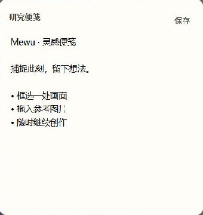

# 研究便笺

这是与对象工具箱业务不同的独立插件：可编辑便笺，加上拖入的参考对象列表。
界面、编辑规则、列表操作和状态格式全部在本包的 `view.mjs` 与 `index.mjs`。
宿主不提供便笺专用接口。

需要 MewuAI 1.0.4 或更新版本，提供 `ui.objects` 与 `objects.library`。
从截图空间左下角的便笺按钮打开浮动对象，内容铺满对象，可通过顶部横条移动和窗口边缘调整大小。
悬停右上角可置顶或关闭；置顶后离开截图空间仍可编辑。
正文自动保存，也可点击保存；Esc 关闭前等待保存，失败时保留正文。
拖入引用、移除引用分别提交对象事务。停用或卸载释放界面，重装同一插件可恢复正文和引用。
应用重启后从便笺按钮重新打开保存的内容；原生窗口位置和置顶状态目前不跨应用重启恢复。


包只含清单、入口和视图模块。MPL-2.0。

## 实际界面



MewuAI 1.0.4 候选版本与本插件 0.1.1 的原生窗口实拍；只裁去了窗口外的桌面。已验证输入、自动保存、Esc 关闭、重开恢复及退出截图后置顶保留。三端完整验收和安装包发布仍在进行。

## 安装

需要 MewuAI 1.0.4 或更新版本。在 Mewu 的插件市场安装，或从本仓库 Releases 下载 ZIP，在设置 → 插件中添加。插件无需 Node.js、Electron 或模型密钥。

## 开发

源码仅包含清单、运行入口和界面模块。依赖由 Mewu 提供的 `@mewu/sdk` 与受控界面桥，无 npm 安装脚本。

在 [Mewu 源码仓库](https://github.com/abnste/mewu_ai) 中编译插件校验器后，用其发行工具对本项目打包：

```sh
node /path/to/mewu_ai/tools/extension-market/cli.mjs pack . --file view.mjs --out mewu-plugin-research-notes-0.1.1.zip --validator /path/to/mewu-plugin-validator
```

插件 ID 保持不变，更新不会另建一份存储。停用和卸载会撤销界面与执行权限，但保留插件自身内容；重装同一插件可以恢复。
